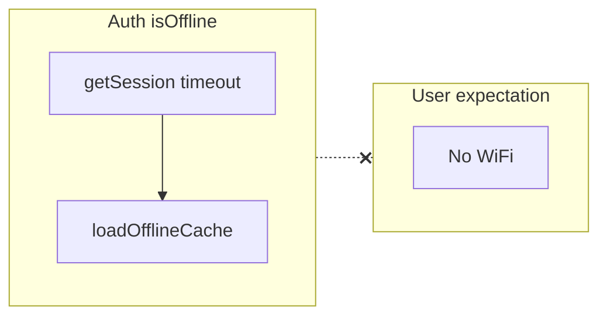

# Pre-release technical audit (Talentia mobile)

This audit is based on the current code under `[talentia-mobile/](c:\Users\User\Desktop\Talentia-v1.0\talentia-mobile)`. Items are ordered by area; each lists a **gap/risk**, **where it shows up**, and a **concrete fix**.

---

## 1. Onboarding flow

| Issue                                                                                                                                                 | Evidence                                                                                                                                                                                                                                    | Fix                                                                                                                                                                                     |
| ----------------------------------------------------------------------------------------------------------------------------------------------------- | ------------------------------------------------------------------------------------------------------------------------------------------------------------------------------------------------------------------------------------------- | --------------------------------------------------------------------------------------------------------------------------------------------------------------------------------------- |
| **Skip awards the same XP and collectible as finishing** — may be intentional, but parents may perceive “skip” as “no reward.”                        | `[app/(auth)/onboarding.tsx](c:\Users\User\Desktop\Talentia-v1.0\talentia-mobile\app\(auth)`\onboarding.tsx) — `handleSkip` duplicates `addXP`, `addItem`, `setOnboardingCompleted` from `handleFinish`.                                    | Product decision: either remove rewards on skip, or rename copy to “Skip intro (reward still granted)” in i18n.                                                                         |
| **No way to go back a step** — only forward / skip; young users or mistaken taps cannot recover without restarting the flow (if you add reset later). | Same file — single `step` state, only `handleNext`.                                                                                                                                                                                         | Add a non-destructive “Back” on steps 2–3, or confirm dialog on skip.                                                                                                                   |
| **Step 1 uses `TaliVideo`** — video/animation on first paint can jank low-end devices or cold start.                                                  | `[onboarding.tsx](c:\Users\User\Desktop\Talentia-v1.0\talentia-mobile\app\(auth)`\onboarding.tsx) + `[TaliVideo](c:\Users\User\Desktop\Talentia-v1.0\talentia-mobile\src\components\TaliVideo.tsx)` (not fully read; flag as perf hotspot). | Lazy-load video, poster frame first, or static illustration on very low memory; test on a mid-range Android profile.                                                                    |
| **Content polish** (you noted) — strings live in locale files under keys `onboarding.step*Title/Body`.                                                | i18n keys referenced from `STEPS` in onboarding.                                                                                                                                                                                            | Editorial pass in `[src/i18n/locales/en.json](c:\Users\User\Desktop\Talentia-v1.0\talentia-mobile\src\i18n\locales\en.json)` / `ru.json` / `ky.json` for reading level and tone (4–10). |

**Routing** is coherent: `[app/index.tsx](c:\Users\User\Desktop\Talentia-v1.0\talentia-mobile\app\index.tsx)` sends users through welcome → parent-setup → onboarding → map when `onboardingCompleted` is false.

---

## 2. Parent report screen

| Issue                                                                                                                                                                                                                                                                                                           | Evidence                                                                                                       | Fix                                                                                                                                                                                                                                |
| --------------------------------------------------------------------------------------------------------------------------------------------------------------------------------------------------------------------------------------------------------------------------------------------------------------- | -------------------------------------------------------------------------------------------------------------- | ---------------------------------------------------------------------------------------------------------------------------------------------------------------------------------------------------------------------------------- |
| **“Weekly” tab inputs are not true weekly metrics** — `lessonsThisWeek` / `correctThisWeek` are derived from **lifetime** `totalAttempts` and `globalCorrectCount` (capped at 20), not last-7-days activity.                                                                                                    | `[app/parent-report.tsx](c:\Users\User\Desktop\Talentia-v1.0\talentia-mobile\app\parent-report.tsx)` ~193–197. | Extend `[progressStore](c:\Users\User\Desktop\Talentia-v1.0\talentia-mobile\src\store\progressStore.ts)` (or analytics queue) with **rolling 7-day** lesson completions / correct counts; pass real values into `getWeeklyReport`. |
| **Reports do not refresh when progress changes** — effect only depends on `activeTab`, `pinVerified`, `language`. If `report` is already set, returning to the screen after more play shows **stale** AI/stub text.                                                                                             | Same file — `useEffect` ~180–203.                                                                              | Add **pull-to-refresh** (`RefreshControl`), a “Refresh” button, or `useFocusEffect` to invalidate `report`/`weekly` when the screen gains focus / on progress bump.                                                                |
| `**useEffect` dependency gap for Overall/Weekly** — `baseStats` (topics, counts) is not in deps; language-only changes reset cache (good), but progress changes do not trigger refetch.                                                                                                                         | parent-report.tsx                                                                                              | Include stable serialized stats or explicit refresh triggers as above.                                                                                                                                                             |
| **By-island fetch keyed only on `completedWorlds.length`** — if completion set changes without length change (unlikely) or world list metadata changes, refetch may not run.                                                                                                                                    | parent-report.tsx ~205–213                                                                                     | Depend on `completedWorlds` identity (e.g. serialized world ids) or refetch when `topics` changes.                                                                                                                                 |
| **Hardcoded English in parent → Tali handoff** — `Child mode: standard` in `handleDiscussWithAI` breaks RU/KY context.                                                                                                                                                                                          | `[parent-report.tsx](c:\Users\User\Desktop\Talentia-v1.0\talentia-mobile\app\parent-report.tsx)` ~225.         | Replace with `t('…')` lines for child mode labels (reuse profile strings if any).                                                                                                                                                  |
| **Loading/error UX** — `generateReport` / `getWeeklyReport` in `[reportService.ts](c:\Users\User\Desktop\Talentia-v1.0\talentia-mobile\src\services\reportService.ts)` **return stubs on failure** (no throw), so parent screen often **cannot distinguish** “offline stub” vs “live AI” unless you add a flag. | `generateReport` catch returns stub ~134–137.                                                                  | Return `{ source: 'network'                                                                                                                                                                                                        |

---

## 3. Offline experience

| Issue                                                                                                                                                                                             | Evidence                                                                                                                                                                                                                           | Fix                                                                                                                                                                                                                                        |
| ------------------------------------------------------------------------------------------------------------------------------------------------------------------------------------------------- | ---------------------------------------------------------------------------------------------------------------------------------------------------------------------------------------------------------------------------------- | ------------------------------------------------------------------------------------------------------------------------------------------------------------------------------------------------------------------------------------------ |
| `**isOffline` is not “no internet”** — it means **Supabase session used offline cache** after timeout/network failure. Users can be online but unable to reach AI backend with **no** map banner. | `[AuthContext.tsx](c:\Users\User\Desktop\Talentia-v1.0\talentia-mobile\src\context\AuthContext.tsx)` ~29–30, 193–203; banner only in `[map.tsx](c:\Users\User\Desktop\Talentia-v1.0\talentia-mobile\app\(tabs)`\map.tsx) ~325–343. | Optionally add `@react-native-community/netinfo` (or Expo NetInfo) for **reachability**; keep auth-offline as a separate “sync limited” state; show consistent badge on Tali/parent report when `!EXPO_PUBLIC_BACKEND_URL` or fetch fails. |
| **First install with no network and no cache** — catch branch clears session if no offline cache; user cannot enter app.                                                                          | AuthContext ~204–208.                                                                                                                                                                                                              | Acceptable for v1 if disclosed; otherwise allow **limited local-only demo** (you already have demo path when Supabase unset).                                                                                                              |
| **Parent report** — no dedicated offline banner; AI failures mostly look like successful stub text (see reportService).                                                                           | reportService + parent-report                                                                                                                                                                                                      | Disclose stub source; optional “network required for live report” when backend configured but unreachable.                                                                                                                                 |

---

## 4. Error handling

| Issue                                                                                                                                                                                                                                                                                                               | Evidence                                                                                                                   | Fix                                                                                                              |
| ------------------------------------------------------------------------------------------------------------------------------------------------------------------------------------------------------------------------------------------------------------------------------------------------------------------- | -------------------------------------------------------------------------------------------------------------------------- | ---------------------------------------------------------------------------------------------------------------- |
| **Report APIs swallow errors** — always fall back to stub; UI `setError` in parent-report only runs for `generateWorldReport` **throws** (world path uses try/catch that sets error on catch ~173–174). Overall/weekly use functions that **resolve** with stub on failure.                                         | `[reportService.ts](c:\Users\User\Desktop\Talentia-v1.0\talentia-mobile\src\services\reportService.ts)` ~111–137, 228–267. | Align behavior: either throw after N retries for UI error state, or return discriminated union with `ok: false`. |
| **ErrorBoundary exposes raw `error.message`** to children — can leak implementation details.                                                                                                                                                                                                                        | `[ErrorBoundary.tsx](c:\Users\User\Desktop\Talentia-v1.0\talentia-mobile\src\components\ErrorBoundary.tsx)` ~60–61.        | Show generic `t('errorBoundary.body')` in production; log details to console/Sentry.                             |
| **Tali: no backend** — quick actions and send both gate on `hasBackend` with `tali.errorNoBackend` in `[TaliModal.tsx](c:\Users\User\Desktop\Talentia-v1.0\talentia-mobile\src\components\TaliModal.tsx)` ~158–160 — consistent (earlier concern about CompanionService offline strings is mitigated by this gate). | —                                                                                                                          | Optional: softer child-friendly copy when URL missing vs server error.                                           |

---

## 5. Performance / startup

| Issue                                                                                                                                                                              | Evidence                                                                                          | Fix                                                                                                                             |
| ---------------------------------------------------------------------------------------------------------------------------------------------------------------------------------- | ------------------------------------------------------------------------------------------------- | ------------------------------------------------------------------------------------------------------------------------------- |
| **Fonts block first paint** — root returns `null` until `useFonts` completes four Nunito variants.                                                                                 | `[app/_layout.tsx](c:\Users\User\Desktop\Talentia-v1.0\talentia-mobile\app\_layout.tsx)` ~92–109. | Reduce font weights if acceptable; subset fonts; or show branded splash longer instead of blank `null`.                         |
| **Double splash hide** — `_layout` hides splash when fonts load; `[app/index.tsx](c:\Users\User\Desktop\Talentia-v1.0\talentia-mobile\app\index.tsx)` hides again when `!loading`. | Both files ~99–107 vs 15–18.                                                                      | Ensure `SplashScreen.preventAutoHideAsync()` once at entry if needed; avoid flicker (Expo docs pattern).                        |
| **Cutting-edge flags** — `newArchEnabled: true` and `reactCompiler` experiment in `[app.json](c:\Users\User\Desktop\Talentia-v1.0\talentia-mobile\app.json)` ~10–11, 55–57.        | —                                                                                                 | Validate release build on **physical mid-range Android**; keep a fallback EAS profile with New Arch off if crashes/jank appear. |
| **Map screen weight** — scroll + background image + many nodes; `[map.tsx](c:\Users\User\Desktop\Talentia-v1.0\talentia-mobile\app\(tabs)`\map.tsx) is large.                      | —                                                                                                 | Profile with React DevTools / `why-did-you-render`; memoize heavy children; consider windowing if lists grow.                   |
| **Lesson screen** — `[app/lesson/[lessonId].tsx](c:\Users\User\Desktop\Talentia-v1.0\talentia-mobile\app\lesson\[lessonId].tsx)` is very large (known from prior work).            | —                                                                                                 | Split task-type subcomponents (future refactor) to reduce re-renders and bundle parse cost.                                     |

---

## 6. Localization

| Issue                                                                                                                                                                                 | Evidence                                                                                                          | Fix                                                                         |
| ------------------------------------------------------------------------------------------------------------------------------------------------------------------------------------- | ----------------------------------------------------------------------------------------------------------------- | --------------------------------------------------------------------------- |
| `**SUBJECT_LABEL` is English-only** — world stats sent to backend use `"Math"`, `"English"`, etc.                                                                                     | `[reportService.ts](c:\Users\User\Desktop\Talentia-v1.0\talentia-mobile\src\services\reportService.ts)` ~140–145. | Map to i18n keys per language or pass canonical ids + let backend localize. |
| **Kyrgyz chart dates use `ru-RU`** — weekday labels may show Russian locale.                                                                                                          | `[parent-report.tsx](c:\Users\User\Desktop\Talentia-v1.0\talentia-mobile\app\parent-report.tsx)` ~42–43.          | Use `ky-KG` if available on device, or document fallback.                   |
| **Hardcoded UI strings** — `'ABA'` methodology badge in `[map.tsx](c:\Users\User\Desktop\Talentia-v1.0\talentia-mobile\app\(tabs)`\map.tsx) ~232–234; `Child mode:` in parent-report. | —                                                                                                                 | Move to `t('map.methodologyAba')` etc.                                      |
| **RTL** — no `I18nManager` / RTL layout usage found (grep only unrelated “direction” fields). LTR-only is OK for RU/EN/KY.                                                            | —                                                                                                                 | No change unless you add Arabic/Hebrew later.                               |

---

## 7. Release blockers (App Store / Google Play / policy)

| Issue                                                                                                                                                                                                   | Evidence                                                                                                            | Fix                                                                                                                                                                                                                                                       |
| ------------------------------------------------------------------------------------------------------------------------------------------------------------------------------------------------------- | ------------------------------------------------------------------------------------------------------------------- | --------------------------------------------------------------------------------------------------------------------------------------------------------------------------------------------------------------------------------------------------------- |
| **No in-app privacy policy / terms** — grep found no `privacy`/`terms` in TS/TSX. Child-facing educational apps often need **clear privacy disclosures** and Play **Families / Data safety** alignment. | —                                                                                                                   | Add a **Settings / Welcome** legal section with links; host policies on HTTPS; match data collected (profile, voice, analytics) to `[analyticsService](c:\Users\User\Desktop\Talentia-v1.0\talentia-mobile\src\services\analyticsService.ts)` / Supabase. |
| **Generic permission strings on iOS** — microphone/speech say “Allow $(PRODUCT_NAME)…” without **child-appropriate purpose**.                                                                           | `[app.json](c:\Users\User\Desktop\Talentia-v1.0\talentia-mobile\app.json)` ~13–15.                                  | Replace with concrete copy: e.g. “Talentia uses the microphone so your child can answer by voice during lessons.”                                                                                                                                         |
| **Display name** — Expo `name` is `talentia-mobile`.                                                                                                                                                    | app.json ~3–4.                                                                                                      | Set user-facing `name` / iOS `CFBundleDisplayName` / Android `label` for store branding.                                                                                                                                                                  |
| **Production builds as APK** in `[eas.json](c:\Users\User\Desktop\Talentia-v1.0\talentia-mobile\eas.json)` — Play prefers **AAB** for new listings.                                                     | eas.json ~11–14.                                                                                                    | Use `app-bundle` for production Android release track.                                                                                                                                                                                                    |
| **Parent PIN stored in plain persisted settings** — `parentPin` in Zustand persist.                                                                                                                     | `[settingsStore.ts](c:\Users\User\Desktop\Talentia-v1.0\talentia-mobile\src\store\settingsStore.ts)` ~136, 125–148. | Document risk (device compromise); optionally hash PIN or use `expo-secure-store` for parental gate (policy expectations vary).                                                                                                                           |
| **Kids / AI** — ensure store questionnaires (Apple **Kids Category**, Google **Teacher Approved** if targeting schools) match actual behavior: account creation, chat, and data retention.              | Signup in `[signup.tsx](c:\Users\User\Desktop\Talentia-v1.0\talentia-mobile\app\(auth)`\signup.tsx).                | Legal/product review beyond code; align marketing and in-app age messaging.                                                                                                                                                                               |

---

## Suggested priority order (engineering)

1. **Correct weekly stats + parent report refresh** — highest user trust impact.
2. **Disambiguate offline/stub vs live AI** for reports and Tali.
3. **Store/policy**: privacy links, permission strings, AAB, display name.
4. **Performance**: font/splash UX + Android device pass with current architecture flags.
5. **i18n cleanup**: subject labels, ABA badge, Tali context string.

This is an audit document; implementation can be split into separate PRs per theme.