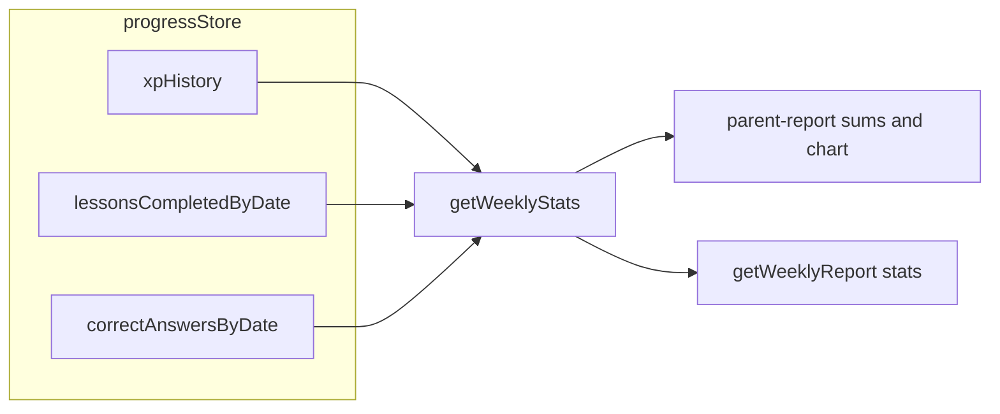

# Weekly stats + stub disclosure plan

## Constraints from codebase

- `[progressStore.ts](c:\Users\User\Desktop\Talentia-v1.0\talentia-mobile\src\store\progressStore.ts)` already persists `**xpHistory**`: local `YYYY-MM-DD` → XP (via `getTodayDateString()` in `addXP`).
- There is **no** historical per-day **lesson completions** or **correct answers** in persisted progress today; `TopicProgress` and globals are cumulative. `[analyticsQueueStore](c:\Users\User\Desktop\Talentia-v1.0\talentia-mobile\src\store\analyticsQueueStore.ts)` has per-event `eventTs` but the queue can shrink after sync and is not a reliable long-term ledger.
- `[XPWeekChart](c:\Users\User\Desktop\Talentia-v1.0\talentia-mobile\app\parent-report.tsx)` builds day keys with `toISOString().slice(0, 10)` (UTC), which can **disagree** with `xpHistory` keys near timezone boundaries. This should be fixed as part of “same source” alignment.

## Part 1 — Real weekly stats

### 1a. Persisted daily rollups (minimal, accurate going forward)

Add two persisted fields on progress state (same `persist` config / `merge` as today):

- `lessonsCompletedByDate: Record<string, number>` — in `**markLessonCompleted`**, after resolving `today` (same pattern as daily goal), do `lessonsCompletedByDate[today] = (lessonsCompletedByDate[today] ?? 0) + 1`.
- `correctAnswersByDate: Record<string, number>` — in `**recordAnswer`**, when `correct` is true, use the same `today` string as streak logic (`getTodayDateString()`), increment `correctAnswersByDate[today]`.

Initialize both as `{}` in initial state and clear in `**resetAll**`.

This does **not** backfill past days before the release; those days correctly show **0** for lessons/correct unless you later add a one-off migration (out of scope unless you ask).

### 1b. `getWeeklyStats()` selector

In `[progressStore.ts](c:\Users\User\Desktop\Talentia-v1.0\talentia-mobile\src\store\progressStore.ts)`:

- Export a type, e.g. `WeeklyDayStat = { date: string; lessonsCompleted: number; correctAnswers: number; xpEarned: number }`.
- Export `**getWeeklyStats()`** that:
  - Builds **7 local calendar days** from **today − 6** through **today** using the **same local `YYYY-MM-DD` helper** as `getTodayDateString()` (extract a shared `formatLocalDate(d: Date)` or loop with `setDate` in local time).
  - For each day key, set:
    - `xpEarned = xpHistory[date] ?? 0`
    - `lessonsCompleted = lessonsCompletedByDate[date] ?? 0`
    - `correctAnswers = correctAnswersByDate[date] ?? 0`
  - Never return `undefined` for numeric fields.

Optional: overload `getWeeklyStats(state)` for unit tests by accepting a partial snapshot; otherwise implement via `useProgressStore.getState()` to match “selector” wording.

### 1c. `parent-report.tsx` wiring

- Call `getWeeklyStats()` (or read from a `useMemo` on store fields) to compute:
  - `lessonsSum`, `correctSum`, `xpSum` = sums over the 7 entries.
- Pass `**getWeeklyReport`** a `WeeklyStats` payload where:
  - `lessonsThisWeek = lessonsSum`
  - `correctThisWeek = correctSum`
  - `weekStartDate` = date string for **oldest** day in the window (today − 6), consistent with a Mon–Sun-style label if you already document “week”; using the **first** day of the 7-day array is fine.
  - Keep `streakCount` from existing `useProgressStore` streak (global streak), unless you explicitly want streak removed—**user request** asks the **third** summary metric to be **XP** summed from the 7-day array. **Replace the third tile** (currently streak in `[parent-report.tsx](c:\Users\User\Desktop\Talentia-v1.0\talentia-mobile\app\parent-report.tsx)` ~561–568) with **weekly XP total** (`xpSum`), and keep **streak** only if you still want it elsewhere (e.g. small caption)—default implementation: **three tiles = lessons | correct | weekly XP** with copy from existing i18n or a short reuse of `parentReport.xpChart` / new key if needed for the label.
- **XP chart**: Refactor `XPWeekChart` to use the **same 7 local dates** as `getWeeklyStats()` (either pass `weeklyStats` in or build one shared `last7LocalDates()` helper in `progressStore` or a tiny `dateUtils` import). Use `**xpEarned`** from each day for bar height so the chart matches the summed XP.

### 1d. `reportService.getWeeklyReport`

- No change to **wording** generation logic: still chooses stub vs backend the same way.
- Input stats from parent-report will now reflect **real** `lessonsThisWeek` / `correctThisWeek` (and backend may still return narrative + optional overrides).

---

## Part 2 — Stub disclosure

### 2a. Types in `[reportService.ts](c:\Users\User\Desktop\Talentia-v1.0\talentia-mobile\src\services\reportService.ts)`

Add `**isStub: boolean`** to:

- `ParentReport`
- `WeeklyReport`
- `WorldReport` (alias of ParentReport — same field)

### 2b. Set `isStub` in all return paths

| Function              | `isStub: true`                                                                | `isStub: false`                              |
| --------------------- | ----------------------------------------------------------------------------- | -------------------------------------------- |
| `generateReport`      | No `BACKEND_URL`; fetch error; any field filled from stub due to `!contentOk` | Successful parse + `contentOk`               |
| `getWeeklyReport`     | No backend; fetch error; stub parts used for language fallback                | Successful backend response with `contentOk` |
| `generateWorldReport` | Same pattern as above                                                         | Success + `contentOk`                        |

Keep existing merge/stub text behavior; only add the flag.

### 2c. UI in `[parent-report.tsx](c:\Users\User\Desktop\Talentia-v1.0\talentia-mobile\app\parent-report.tsx)`

- After the main title/subtitle block (and before or after the live-session card—**prefer immediately under subtitle** to match “below the report header”), render a **non-blocking** banner when:
  - **Overall tab**: `report?.isStub === true`
  - **Weekly tab**: `weekly?.isStub === true` (same banner component / style)
  - **By-island**: optional small line inside each world card when `wr.isStub` (if you want parity; user text focused on main report—can be minimal).

Style: muted **amber/yellow** background (`#FFF3CD`-style or `theme`-safe), small `AppText variant="small"`, padding, rounded—mirror tone used for offline banner on `[map.tsx](c:\Users\User\Desktop\Talentia-v1.0\talentia-mobile\app\(tabs)`\map.tsx).

### 2d. i18n

Add `**parentReport.stubNotice`** to `[en.json](c:\Users\User\Desktop\Talentia-v1.0\talentia-mobile\src\i18n\locales\en.json)`, `[ru.json](c:\Users\User\Desktop\Talentia-v1.0\talentia-mobile\src\i18n\locales\ru.json)`, `[ky.json](c:\Users\User\Desktop\Talentia-v1.0\talentia-mobile\src\i18n\locales\ky.json)` with the exact strings you provided.

### 2e. Tests / types

- Update `[reportService.test.ts](c:\Users\User\Desktop\Talentia-v1.0\talentia-mobile\src\services\__tests__\reportService.test.ts)` only if assertions need `isStub` on mocked returns.
- Run `npx tsc --noEmit` in `talentia-mobile`.

---

## Files to touch (expected)

| File                                                                                                       | Role                                                                                |
| ---------------------------------------------------------------------------------------------------------- | ----------------------------------------------------------------------------------- |
| `[progressStore.ts](c:\Users\User\Desktop\Talentia-v1.0\talentia-mobile\src\store\progressStore.ts)`       | Daily maps, `getWeeklyStats`, `resetAll`                                            |
| `[parent-report.tsx](c:\Users\User\Desktop\Talentia-v1.0\talentia-mobile\app\parent-report.tsx)`           | Sums, `getWeeklyReport` args, XP chart source, third tile = weekly XP, stub banners |
| `[reportService.ts](c:\Users\User\Desktop\Talentia-v1.0\talentia-mobile\src\services\reportService.ts)`    | `isStub` on types and all returns                                                   |
| `[en.json` / `ru.json` / `ky.json](c:\Users\User\Desktop\Talentia-v1.0\talentia-mobile\src\i18n\locales\)` | `parentReport.stubNotice` + optional label for weekly XP tile if needed             |

